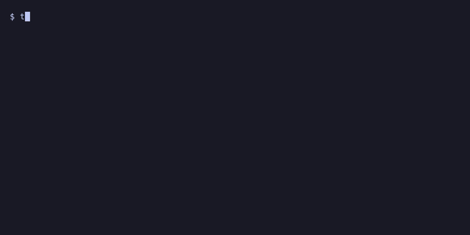
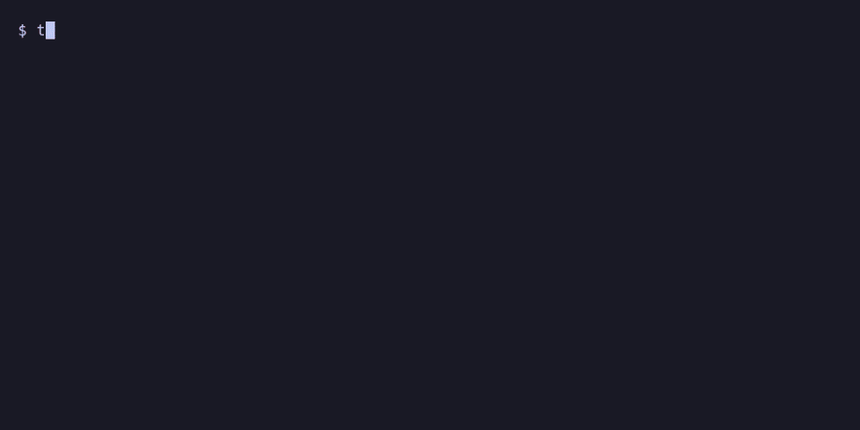
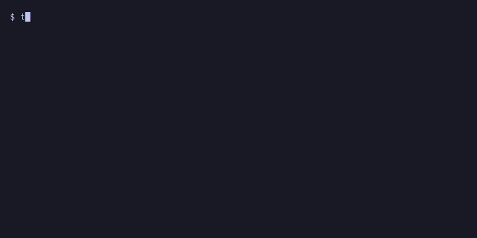

# tminus

A countdown timer for your terminal, styled after [Omarchy](https://omarchy.org)'s
screensaver: big block digits in your theme's colors, with animated text effects
that replay every so often.



## Features

- **All 37 effects of Omarchy's screensaver**, adapted from
  [TerminalTextEffects](https://github.com/ChrisBuilds/terminaltexteffects):
  beams, binarypath, blackhole, bouncyballs, bubbles, burn, colorshift, crumble,
  decrypt, errorcorrect, expand, fireworks, highlight, laseretch, matrix,
  middleout, orbittingvolley, overflow, pour, print, rain, randomsequence,
  rings, scattered, slice, slide, smoke, spotlights, spray, swarm, sweep,
  synthgrid, thunderstorm, unstable, vhstape, waves and wipe — shortened to at
  most a few seconds each so the clock stays readable. `matrix-heavy` is a
  denser full-screen matrix you can pick with `--effect`.
  Digits also scramble briefly as they tick.
- **Themes**: on Omarchy, every installed theme with its real colors (read
  from its files, so custom themes work too), defaulting to the active one;
  built-in versions of the stock themes elsewhere; and your own.
- **Final-seconds alert**: the background pulses with each tick, and big effects
  pause so the seconds stay readable. Effects only start if they'll finish
  before then, so short timers get short effects (a 10-second one gets none).
- **Accurate**: duration timers keep counting through suspend (Linux and
  macOS), and `--until` follows the wall clock, so it handles NTP corrections
  and DST. Count down to a time, a weekday or a date days away.
- **Sequences** like `25m:work 5m:break x4`, a built-in `@pomodoro`, and your
  own presets.
- **Remote control and Waybar**: watch and steer a timer from your bar or
  keybindings, or run it with no window at all.
- Tenths/hundredths of a second, a progress bar, large or small titles, and
  overtime counting after zero.

## Install

The command is called **`t-`** (as in T-minus).

- **Binaries** for Linux (x86_64, aarch64) and macOS (Apple silicon) are on the
  releases page, with completions and a man page.
- **Arch / Omarchy**: a `PKGBUILD` is in `packaging/aur/`.
- **From source** (Rust 1.88 or newer):

  ```sh
  cargo install --git https://github.com/seagleNet/tminus
  # or from a checkout:
  cargo install --path .
  ```

Shell completions and the man page come from the binary itself. Completions
ask `t-` on each Tab, so they know your themes (built-in, Omarchy and config).
Hook them up in your shell's startup file:

```sh
COMPLETE=fish t- | source            # fish: ~/.config/fish/completions/t-.fish
source <(COMPLETE=zsh t-)            # zsh:  ~/.zshrc
source <(COMPLETE=bash t-)           # bash: ~/.bashrc
t- man > ~/.local/share/man/man1/t-.1
```

`t- completions <shell>` prints the same hook as a file, as the packages
install it.

## Usage

```sh
t- 25m                            # also: 90, 45s, 1h30m, "1h 5m 10s", 10:00, 1:30:00
t- 25m -t "deep work"             # with a title
t- --until 17:30 -b               # count down to a time of day, with a progress bar
t- --until "fri 17:00"            # also: "tomorrow 9:00", 2026-12-24, "2026-12-24 18:00"
t- 5m -d 2                        # show hundredths
t- 10m --effect matrix,burn       # only these effects (or none)
t- 10m --zero-effect burn         # a different effect at zero (also --intro-effect)
t- 25m --effect-align 30          # effects finish exactly as the clock hits :30 or :00
                                  #   (--every is rounded up to a multiple of it)
t- 25m --done-text BREAK          # a big word instead of 00:00 at the end
t- 3h --hide-seconds              # 2h 59m instead of 2:59:59
t- 25m --sound ~/ding.ogg --exec 'hyprctl notify 1 5000 0 "done"'   # at zero
t- --until 9:00 --status-pos bottom --status-align right   # status line in the corner
t- 25m --exit && notify-send "break time"
```

| Key | Action |
|---|---|
| `space` / `p` | pause / resume |
| `e` / `enter` | play another effect now |
| `n` / `b` | next / previous segment of a sequence |
| `t` | next theme |
| `s` | switch title between large and small |
| `c` | cycle status line time: off / time of day / time left |
| `+` / `-` | add / remove one minute |
| `r` | restart (the current segment) |
| `h` / `?` | show / hide the keys popup |
| `q` / `esc` | quit |

## Sequences

Give several durations to run them back to back. Each can have a `:label`
(shown as the title) and an `@theme`; `xN` repeats what came before it:

```sh
t- 25m:work 5m:break x4                    # four pomodoros
t- 25m:work@nord 5m:break@everforest x4    # a theme per segment
t- 50m:focus 10m:break --confirm           # wait for a key before each next segment
t- @pomodoro                               # built in: 4×25m work with 5m breaks,
                                           #   a 15m long break after the 4th
t- @focus                                  # your own preset (see Configuration)
```

The status line shows progress and what comes next (`● ◐ ○ ○ · next: break 5m`,
the name in that segment's theme color; `t- ctl status` has it in the tooltip);
`n`/`b` skip forward/back, and `--bar-total` makes the progress bar cover the
whole sequence. Each segment change rings the bell, flashes, and (with
`--notify`) sends a notification.

## At zero



Besides the bell and the background flash, tminus can tell you in other ways,
at the end and at every segment change of a sequence:

- `--notify`: a desktop notification (`notify-send`)
- `--sound FILE`: play a sound (with `pw-play`, `paplay`, `aplay` or `afplay`)
- `--exec CMD`: run a shell command; it gets `TMINUS_EVENT` (`segment` or
  `done`), `TMINUS_LABEL`, `TMINUS_NEXT` and `TMINUS_TITLE`

## Remote control and Waybar

Every running timer can be watched and controlled from outside:

```sh
t- ctl list               # the running timers: name, PID, headless or window, state, clock
t- ctl status             # one line of JSON
t- ctl status --follow    # a line per change, for a Waybar custom module
t- ctl toggle             # also: pause, resume, add 5m, sub 1m, restart, next, back, effect, stop
```

Waybar module:

```jsonc
"custom/tminus": {
  "exec": "t- ctl status --follow",
  "return-type": "json",
  "on-click": "t- ctl toggle",
  "on-click-right": "t- ctl stop",
  "on-scroll-up": "t- ctl add 1m",
  "on-scroll-down": "t- ctl sub 1m"
}
```

The JSON's `class` is `running`, `paused`, `alert` (final seconds), `waiting`
(between segments with `--confirm`), `done`, or `idle` (no timer; the text is
empty so Waybar hides the module), for styling in Waybar's CSS.

`--headless` runs a timer with no window at all, so it lives only in your bar;
bind it to a key, e.g. in Hyprland:

```
bind = SUPER, T, exec, t- 25m:work 5m:break x4 --headless --notify
bind = SUPER SHIFT, T, exec, t- ctl toggle
```

With several timers running, give them names (`--name tea`) and pass the same
`--name` to `t- ctl`; otherwise it acts on the newest timer (marked `*` in
`t- ctl list`). `t- status` from earlier versions still works.

`t- --help` lists every option; `--list-themes` and `--list-effects` show
what's available.

To see them, run `t- --demo`: a live clock showing one effect on repeat. `←`/`→`
switch the theme, `↑`/`↓` the effect, `a` moves on to the next effect after each
one, `r` picks a random effect, and `f` previews the final seconds and the flash
at zero. `q` quits and prints your choice (`--theme nord --effect rain`) to
paste into a command or the config. Other options apply as usual, so `t- --demo
1:30:00 -f block -t focus` previews exactly that look.



## Configuration

Defaults for any option can go in `~/.config/tminus/config.toml` (or
`$XDG_CONFIG_HOME/tminus/config.toml`). Keys are the long option names, with
`-` or `_`; command-line options override the file.

```toml
theme = "nord"
title = "focus"
title-size = "small"
effect = ["decrypt", "matrix", "burn"]
every = 45
bar = true
decimals = 1
alert = 15
status-pos = "bottom"
status-align = "right"
status-time = "now"     # or "left", "off"

[presets]
focus = ["50m:focus", "10m:break", "x3"]
tea = ["3m:steep@gruvbox", "2m:cool"]
pomodoro = ["30m:work", "5m:break", "x4"]   # replaces the built-in one
```

Use `--config PATH` to read a different file, or `--no-config` to ignore it.
Every on/off option has an opposite (`--no-bar`, `--no-notify`, `--no-confirm`,
`--bell`, `--tick-fx`, ...) to turn a config setting off for one run.

### Custom themes

Define themes in the same file and pick them with `theme = "..."` or `--theme`:

```toml
[themes.sunset]
gradient = ["#ff7e5f", "#feb47b", "#ff6f91"]  # colors the clock cycles through
dim   = "#6b5b6e"   # optional: secondary text and borders
flash = "#fff4e6"   # optional: highlights in effects
bg    = "#1d1520"   # optional: where the final-seconds flash fades to if the
                    # terminal doesn't report its background
alert = "#ff3b3b"   # optional: final-seconds warning color

[themes.my-nord]
base = "nord"       # start from a built-in theme and change only some colors
alert = "#ffab40"
```

Missing colors are derived from the gradient (or taken from `base`). A custom
theme with a built-in's name replaces it, and one named after an Omarchy theme
takes precedence over the colors read from that theme's files. Custom themes show up
in `--list-themes` and when cycling with `t`.

**Exit codes:** `0` the countdown finished, `1` you quit early, `2` bad arguments.

## Credits

The text effects are adaptations of those in
[TerminalTextEffects](https://github.com/ChrisBuilds/terminaltexteffects) by
ChrisBuilds and its Rust port [ttfx](https://github.com/omacom/ttfx), which
Omarchy's screensaver uses. Both are MIT licensed; see `LICENSE`.

## License

MIT
